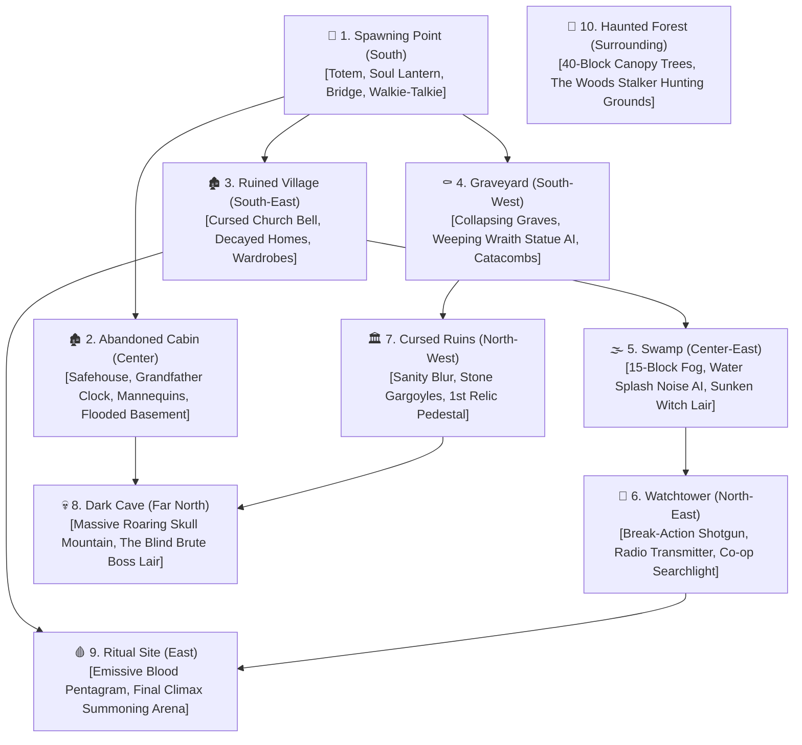

# 🌲 The Forgotten Woods — Minecraft Horror Addon (Master State & Directives)

> [!IMPORTANT]
> **MANDATORY DIRECTIVE FOR ALL AI AGENTS & CHAT SESSIONS:**  
> 1. You **MUST** read this file at the start of any conversation regarding this project.  
> 2. You **MUST** update the **Progress Log**, **Current Phase**, and **Next Action Items** in this file at the conclusion of any modifications.  
> 3. Never overwrite or remove existing completed deliverables without explicit user instruction.

---

## 📌 Project Overview
* **Project Name:** The Forgotten Woods (Minecraft Horror Addon & Adventure Map)
* **Target Platform:** Minecraft Bedrock Edition (MCPE, Windows 10/11, Console)
* **Engine Architecture:** Bedrock Resource Pack (RP) + Behavior Pack (BP) + `@minecraft/server` Script API + Deferred PBR
* **Map Dimensions:** `1,000 x 1,000` Blocks (High-Density Atmospheric Island)
* **Core File Path:** `D:\do note delete\Desktop\MC horror mod\`
* **MCP Server Tooling:** `d:\do note delete\Downloads\BlockBench MCP Server\`
* **GitHub Repository:** [`git@github.com:iamrahultungariya/HorrorMCAddon.git`](https://github.com/iamrahultungariya/HorrorMCAddon)

---

## 🗺️ Map Topology (1,000 x 1,000 Island — 10 Points of Interest)

---

## 🎮 Core Gameplay & Horror Mechanics Architecture

### 1. Deterministic Noise & Trigger Engine (No Vague Mechanics)
* **Door & Chest Creak (`door_creak.ogg`):** Opening doors or rusted chests while standing emits noise (alerts monsters within 25 blocks). Crouching (`Sneak`) allows 100% silent opening.
* **Physics Clatter & Distraction:** Dropping metal items or throwing **Glass Bottles / Stone Pebbles** creates localized impact vibrations; monsters sprint to investigate the point of impact (*Alien: Isolation* style).
* **High-Risk Gunplay:**
  * **Weapon:** *Rusted Double-Barrel Break-Action Shotgun* (2-shot capacity, 25 HP close-range blast damage).
  * **The Trade-off:** Extremely scarce ammo (6-8 shells on entire map). Deafening muzzle blast (`shotgun_blast.ogg`, 60-block radius) alerts every creature in the forest!
* **Flashlight High-Beam Stun:** Focusing beam on monster's face stuns for 2.5s, consumes 20% battery, and enrages monster speed afterward.

### 2. Location-Specific Jumpscares & Traps
* **Graveyard:**
  * *Trap:* Collapsing Grave (breaks floor, plunges player into dark crypt).
  * *Monster:* **The Weeping Wraith** (Moves only when player turns their back / Sight-Angle AI; freezes when stared at).
  * *Jumpscare:* Crows erupting from dead crosses with loud wing clatter.
* **Abandoned Cabin (Mansion):**
  * *Jumpscare 1:* Headless Wooden Mannequin shifts position when player turns around.
  * *Jumpscare 2:* Sudden Grandfather Clock chime shattering glass.
  * *Jumpscare 3:* Lightning flash revealing The Stalker pressed against window glass.
  * *The Basement Nightmare:* Waist-deep water (slowness) to reset electrical fuse box.

### 3. Survival Evasion Systems
* **Wardrobe / Cupboard Hiding:** Player enters wardrobe, screen gets eye-slit vignette, monster sniffs outside and leaves if silent.
* **Barricading:** Hammer 3 wooden planks over doors to force monster into 3 claw-strike break animations (15s escape window).
* **Bear Traps:** Place on ground to snare and immobilize monster for 5 seconds (`CLANG!`).

---

## 📦 Deliverables & File Registry (`D:\do note delete\Desktop\MC horror mod\`)

| File / Directory | Category | Status | Details |
| :--- | :--- | :--- | :--- |
| `the_woods_stalker.bbmodel` | 3D Model | ✅ Ready | 3.2m Wendigo, 26 cubes, Box UV, 64x64 texture, 5 animations |
| `crypt_crawler.bbmodel` | 3D Model | ✅ Ready | 4-legged creeping skeleton, crawling kinematics, 64x64 texture |
| `the_ancient_one.bbmodel` | 3D Model | ✅ Ready | Colossal 4-armed Elder Boss, magma veins, 128x128 texture |
| `forgotten_lantern.bbmodel` | 3D Item | ✅ Ready | Handheld 3D Soul Lantern with cage and flame core |
| `cursed_totem.bbmodel` | 3D Prop | ✅ Ready | Blood skull warning marker |
| `blood_altar.bbmodel` | 3D Prop | ✅ Ready | Pentagram ritual altar with emissive blood runes |
| `rusty_bear_trap.bbmodel` | 3D Prop | ✅ Ready | Snapping jaw bear trap |
| `the_forgotten_woods_RP/` | Resource Pack | ✅ Ready | Unified RP with models, textures, animations, lang files |
| `the_forgotten_woods_BP/` | Behavior Pack | ✅ Ready | Unified BP with 3 entities, custom AI components, spawn rules |
| `The_Forgotten_Woods_Ultimate.mcaddon` | Installer | ✅ Ready | 1-Click Bedrock package (19.3 KB) |
| `EXECUTION_PLAN.md` | Master Roadmap | ✅ Ready | Detailed phase-by-phase execution blueprint for new chats |
| `MCP_SERVER_GUIDE.md` | Documentation | ✅ Ready | Complete user & setup guide for Blockbench MCP server at home |
| `mcp-server/` | Engine Tooling | ✅ Ready | TypeScript MCP Server source, generators, tests, and archiver |
| `PROJECT_STATE.md` | Master State | ✅ Live | Mandatory tracking file for project evolution |

---

## 🗓️ Phase-by-Phase Roadmap

### Phase 1: Core 3D Modeling & Animation (✅ COMPLETED)
- [x] Initialized headless Blockbench MCP environment.
- [x] Engineered 4 custom 3D models with proper bone pivot hierarchies.
- [x] Generated procedural textures with Sharp (bone, blood, charcoal bark, magma veins).
- [x] Created procedural animations (idle, walk, crawl, attack, ground slam).
- [x] Bundled initial `.mcaddon` packages.

### Phase 2: Weapons, Items & Script Engine (🔄 NEXT UP)
- [ ] 3D Model: Break-Action Double-Barrel Shotgun + 12-Gauge Shells.
- [ ] 3D Model: Throwable Glass Bottle & Stone Pebble.
- [ ] Bedrock Script API (`@minecraft/server`):
  - [ ] Sound detection on un-sneaked door/chest opening (`door_creak`).
  - [ ] Throwable projectile vibration trigger (diverting monster path).
  - [ ] Shotgun raycast damage, knockback & deafening 60-block sound broadcast.
  - [ ] Wardrobe hide/unhide camera controller.
  - [ ] Door plank barricade interaction.

### Phase 3: Location Horrors & Jumpscare State Machines
- [ ] Weeping Wraith Sight-Angle checking AI (freezes on FOV, stalks when back is turned).
- [ ] Mansion Mannequin relocation script.
- [ ] Graveyard collapsing grave trigger block.
- [ ] Window peeker lightning event.
- [ ] Flooded basement fusebox sequence.

### Phase 4: World Construction (1,000 x 1,000 Island)
- [ ] WorldPainter heightmap generation from minimap illustration.
- [ ] Custom 35-45 block dead pine/redwood tree canopy brushes.
- [ ] Amulet Editor integration: placing the 7 core structures (Cabin, Village, Graveyard, Ruins, Watchtower, Cave, Ritual Site).

### Phase 5: Deferred Shading, Audio & Final Release
- [ ] PBR MER textures (wet mud, rusted metal, emissive blood pentagram).
- [ ] Dynamic volumetric fog JSON per biome (Dense swamp fog vs cold grey forest fog).
- [ ] JSON UI: Vanilla HUD removal + Bodycam grain/vignette overlay.
- [ ] 3D Positional `.ogg` horror audio suite.
- [ ] Final `.mcworld` + `.mcaddon` release bundling.

---

## 📝 Change Log & Session History
* **2026-11-05 (Session 1):**
  - Generated `the_woods_stalker`, `crypt_crawler`, `the_ancient_one`, `blood_altar`, and `rusty_bear_trap`.
  - Resolved texture binding UUID issue for seamless Blockbench viewport shading.
  - Packaged unified `The_Forgotten_Woods_Ultimate.mcaddon`.
  - Shifted horror mechanics from vague concepts to deterministic action triggers (Creaking doors, throwables, shotgun, wardrobe hiding).
  - Created `PROJECT_STATE.md` as permanent master project directive.
  - Initialized Git repository and pushed live to GitHub: `git@github.com:iamrahultungariya/HorrorMCAddon.git`.
  - Integrated `mcp-server/` codebase into the repository and created `MCP_SERVER_GUIDE.md` for seamless setup at home.
